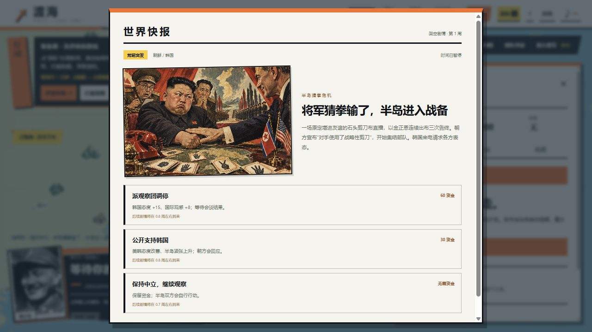

# 渡海 · 反攻大陆

**[直接玩，无需登录](https://mnxd2a6.github.io/chiang-kai-shek-simulator/)** · 当前游戏版本 **1.11.0**

这是这个仓库现在的主游戏。原来的“蒋介石模拟器”首页已经切换到《渡海·反攻大陆》，以前分享的主页链接会直接进入新版。



原创中文单人 2D 实时战略：点军队或舰船，再点城市、敌舰或海域下令。筹备阶段可以处理国际风波、发展经济、护送补给和推进秘密科研，再决定何时登陆。

## 当前玩法

- **简单指挥**：独立军队移动、攻城、驻守；运输舰渡海，驱逐舰与导弹艇交战。可随时暂停下令。
- **战场反馈**：机甲行走、城市旗帜、实际受击数字、登岸与占城动画。选陆军后直接点左上城市下令，当前命令和两种胜利路线可随时查看。
- **国际剧情**：34 个事件、后续与结局，85 项回应，每个事件都有独立复古手绘海报。包含半岛猜拳危机、俄罗斯机甲、黄鸭堵港、企鹅大使等架空剧情。
- **新闻 / 关系 / 机密**：重大新闻自动暂停，选择2–3项简单回应之一；国家态度、舆论和制裁实际影响经济、合作与援军。
- **曙光计划**：抽象的经费、科研进度与暴露风险。完成后可保留储备、公开威慑、谈判停火或实际使用；使用会导致制裁、撤援和进入地图的国际干预舰队。
- **直接运行**：静态 HTML / CSS / JavaScript，无新增运行时依赖、无账号或 API key。自动存档，支持 JSON 导出和导入。

## 开始玩

1. 打开[游戏网站](https://mnxd2a6.github.io/chiang-kai-shek-simulator/)，点“进入指挥”。
2. 点右上“国际”，切换新闻、关系、机密。首条重大新闻约12秒后出现，选一项回应即可继续时间。
3. 想直接打仗，可从左上选择护送补给或拦截敌舰；准备好后选择登陆。军队和舰船均用“点单位 → 点目标”操作。

详细规则、素材许可与版本记录见 [当前游戏说明](counteroffensive/README.md)。[1.11实玩复盘与验证](counteroffensive/docs/QA-1.11.md)记录正常操作赢下的一局及测试范围，不代表人工走遍所有剧情。

## 本地运行与 GitHub Pages

```sh
npm start
```

打开 `http://127.0.0.1:43891/`，首页自动进入当前游戏。无需 `npm install`，开发脚本使用 Node.js 22+。

```sh
npm test
npm run build
```

推送至 `main` 后，GitHub Actions 运行测试、构建并部署 GitHub Pages。`dist/` 可直接托管。当前游戏源代码在 [counteroffensive/](counteroffensive/)，它也能单独运行与构建；网站现有子路径和存档来源保持连续。

## 旧版与创作说明

原像素探索、电话互动和十二城回合游戏保留为[旧版归档](legacy-simulator.html)，[原说明](docs/legacy-simulator.md)也保留。默认入口和当前开发对象是《渡海·反攻大陆》。

本游戏的阵营、剧情、数字与结局均为架空创作，不代表真实人物言行或现实军事预测。代码采用 MIT 许可；历史照片、地图数据及生成素材的来源和说明见当前游戏文档。
