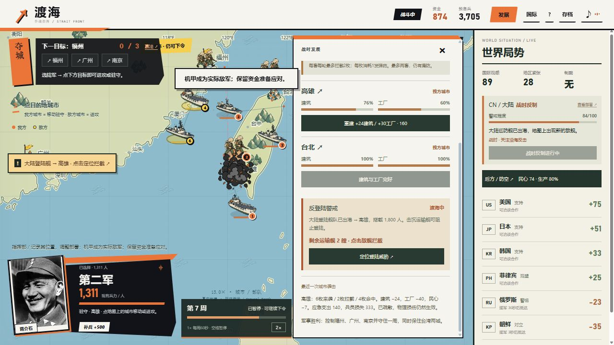

# 渡海 · 反攻大陆 2.3

**[直接玩，无需登录](https://mnxd2a6.github.io/chiang-kai-shek-simulator/counteroffensive/?v=2.3.0)**

恢复真实地图上的实时指挥：点军队，再点城市，自动移动、进攻或驻守。右侧保留各国状态，显示关系、合作是否生效、援军进度和大陆动态。



## 怎么开始

1. 点“发展”，先做经济，再做科技。资金和预备兵会自动增长。
2. 点军队，按“补兵”；准备好后点“准备登陆”。每支同时渡海的陆军需要一艘运输舰。
3. 点军队，再点福州、广州、南京。控制三城并守满一周，抵御两轮城市空袭、击退两次登陆，同时保住台北与高雄。
4. 导弹会损伤城市和工厂、降低民心；提前买防空，袭击后重建并拦截大陆登陆舰；也可以选择秘密科研、公开威慑后谈判停火。

## 2.3的变化

- 三城占领后还需实际经历两轮空袭、击退两次登陆；进行中的导弹与登陆会阻止提前结算。
- 左上显示空袭、反登陆和守城进度，直接提示还差哪一步。
- [新胜利规则](counteroffensive/docs/counterattack-2.3.md) · [画风对照预览](counteroffensive/docs/art-direction/)。

## 2.2的变化

- 疏散只减人员伤亡。城市建筑、工厂、应急资金与民心仍会受损，收入持续下降。
- 新增“后方 / 防空”：查看逐城损伤，支付160并等待重建。
- 美国防空每套900，需要交付、消耗弹药且可能漏防；缺几枚就按实际数量补弹。
- 大陆公告反向登陆，实际派出运输舰、护航舰和上岸部队。拦截舰队与本岛驻军都能发挥作用。
- 军事胜利增加守住一周与保住台湾的要求；失败明确说明民心、设施或城市失守原因。

[具体数值与操作](counteroffensive/docs/homefront-2.2-rules.md)。

## 实时世界功能

- 默认每周60秒，进度条显示本周推进和距下周时间。随时暂停或切换2倍速；没有30回合截止线。
- 开场从符合条件的国际事件中随机抽取，后续出现时间也有变化，保留选择决定的故事走向。
- 大陆会根据扩军、合作、科研和登陆作出回应：先预告，再实际施压、动员、派舰或反击。点“查看部署”定位地图。
- 筹备期花50资金沟通，可取消当轮待执行部署；已经出现的军队不会消失。

## 保留的内容

- Natural Earth真实海岸线和城市坐标，包含太平洋两岸；可查看美国、日本、台湾、俄罗斯、朝鲜等地区。
- 手绘军队、舰船、机甲、城市旗帜与命中特效；蒋介石1945年历史照片与可开关音效。
- 34个架空国际事件、后续与结局，85项回应，每个事件有独立复古手绘插图。
- 国家关系、舆论、贸易与制裁影响实际收入和支援；科研以抽象进度与风险进行。实际使用战略储备会触发严重后果，不会自动胜利。
- 自动保存与JSON导入导出；桌面和手机尺寸布局。

[2.2实玩与验证范围](counteroffensive/docs/QA-2.2.md) · [详细规则与素材许可](counteroffensive/README.md)

## 运行和发布

```sh
npm start
npm test
npm run build
```

本地打开 `http://127.0.0.1:43891/`。无需安装运行时依赖，开发脚本需要Node.js22+。推送到main后，GitHub Actions测试、构建并部署GitHub Pages。

## 旧版与存档

实时版新存档键为`strait-front-v9`，会读取旧实时进度并保留原键；旧设施损伤继续生效。[六角格2.0存档入口](counteroffensive/hex.html)、[六角格旧说明](counteroffensive/docs/README-hex-2.0.md)与[原像素模拟器归档](legacy-simulator.html)均保留。默认游戏源码位于[counteroffensive/](counteroffensive/)。

本作是原创单人架空策略游戏，事件对话、数值和结局不代表现实历史。源代码采用MIT许可；历史照片、地图、手绘素材的来源与许可见游戏说明。
