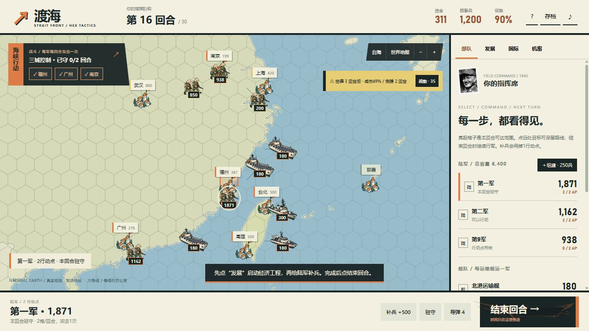

# 渡海 · 反攻大陆 2.0

**[直接玩，无需登录](https://mnxd2a6.github.io/chiang-kai-shek-simulator/counteroffensive/?v=2.0.0)**

真实地图上的六角格回合战略。选中陆军或舰船，点六角格或城市下令，再点“结束回合”推进战局。查看地图、建设和回应新闻时，敌军不会在后台偷偷行动。目标节奏为10–20分钟一局；思考时间因玩家而异。



## 怎么开始

1. 点“进入指挥”。右侧“发展”可建设经济、科技或外交，每项工程一回合完成。
2. 预备兵要点“补兵＋500”转入选中的陆军，每次使用1行动点。陆军每回合2行动点，舰船3行动点，每军最多攻击一次。
3. 准备好后，从“部队”面板选择登陆。陆军点远处城市可保留路线；空运输舰会花自己的行动点前往接运，每舰运输一军。
4. 攻击前确认损失预览；空袭和俄朝援军显示剩余回合。提前疏散、修复设施、补兵驻守。
5. 同时控制福州、广州、南京并守住两轮，或通过未使用储备的威慑谈判停火。战略窗口共30回合，失败时显示直接原因。

## 保留的内容

- Natural Earth真实海岸线和城市坐标，包含太平洋两岸；可查看美国、日本、台湾、俄罗斯、朝鲜等地区。
- 手绘军队、舰船、机甲、城市旗帜与命中特效；蒋介石1945年历史照片与可开关音效。
- 34个架空国际事件、后续与结局，85项回应，每个事件有独立复古手绘插图。
- 国家关系、舆论、贸易与制裁影响实际收入和支援；科研以抽象进度与风险进行。实际使用战略储备会触发严重后果，不会自动胜利。
- 自动保存与JSON导入导出；桌面和手机尺寸布局。

[实玩复盘与验证范围](counteroffensive/docs/QA-2.0.md) · [详细规则与素材许可](counteroffensive/README.md)

## 运行和发布

```sh
npm start
npm test
npm run build
```

本地打开 `http://127.0.0.1:43891/`。无需安装运行时依赖，开发脚本需要Node.js22+。推送到main后，GitHub Actions测试、构建并部署GitHub Pages。

## 旧版与存档

回合版使用独立存档键，不覆盖v7实时存档。[1.11实时版与旧存档](counteroffensive/realtime.html)和[原像素模拟器归档](legacy-simulator.html)继续保留。默认游戏源代码在[counteroffensive/](counteroffensive/)。

本作是原创单人架空策略游戏，事件对话、数值和结局不代表现实历史。源代码采用MIT许可；历史照片、地图、手绘素材的来源与许可见游戏说明。
