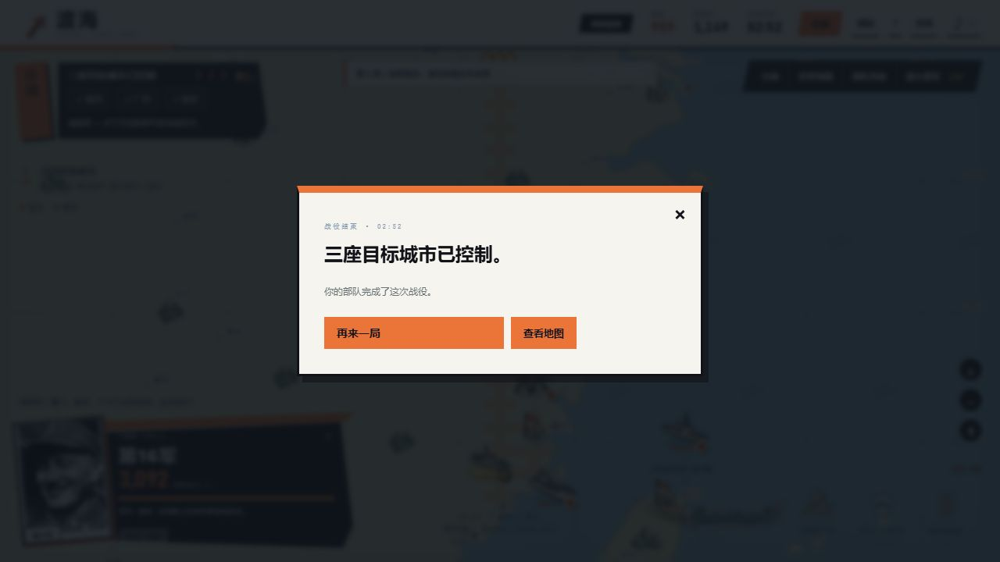
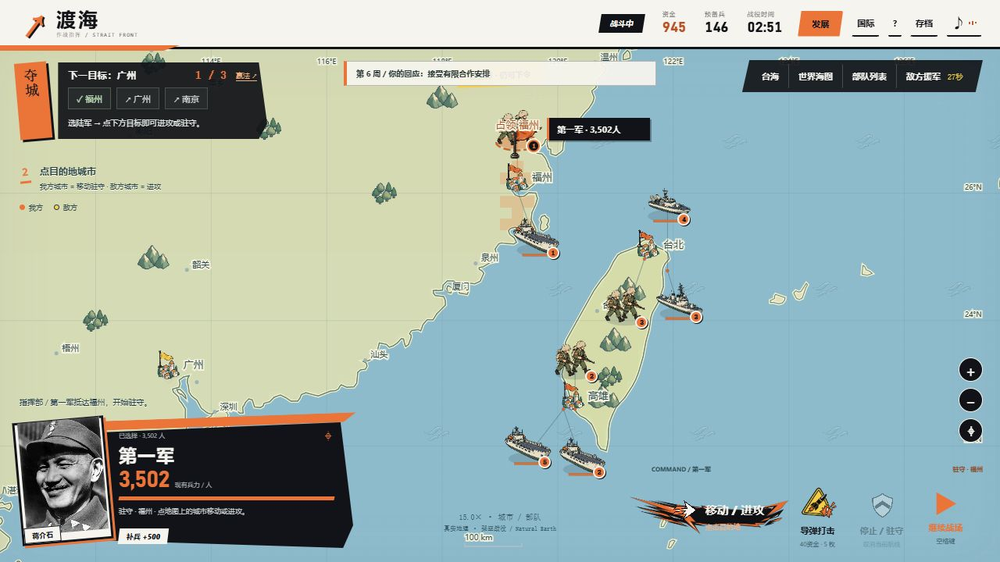

# 1.11 战场反馈与实际胜利复盘

日期：2026-10-15。正常浏览器新开局，正常速度，未修改存档、兵力、资金、随机数或游戏时间。中途重载一次恢复同一局以验证面板修复；资源与待决新闻继续保留。

## 本次改进

- 原创透明手绘机甲四帧行走、两色驻守旗，完整提示词和哈希见 [素材记录](../assets/field-cel/manifest.json)。已有步兵、舰船、地图、照片和34张事件插图保留。
- 实际受伤才显示损失数字；短时间伤害合并。真实登岸、到达和占城分别产生水花、回弹、升旗；停止不伪装成到达，载入不重播旧伤害。
- 地图上的部队有行军重心、舰船轻微起伏、受击偏移和少量血条。模拟与表现都跟随战役时间，减少动态效果模式保留静态信息。
- 选陆军后直接点左上目标城市下令；无陆军选择时仅定位。已占领的目标会成为移动驻守命令。当前指令、目的地、移动预计时间可见，预计时间不包含交战。
- “赢法”解释两条真实结局路线。运输舰载兵时显示运兵，不能独立改令时指导玩家选择陆军。
- 修复发展面板遮住暂停的问题。1280×720面板底部586、暂停顶部608；390×844面板底部711、暂停顶部747。手机战斗说明底部150、导航顶部170，不再重叠。

## 我实际怎么赢的

| 战役时间 | 正常操作 | 用意 |
|---|---|---|
| 00:12–01:08 | 依次把经济升至3级；新闻选择调停、有限援助或免费核实 | 提高持续收入与总兵力容量，保留发展预算 |
| 01:22–02:06 | 科技逐级升至3；援助结束后不追加预算 | 降低进攻损耗并准备空袭防护 |
| 02:07–02:31 | 外交支援升至1级；完成后被动减伤70%，设施100% | 增加700预备兵和空袭间隔；这是发展项目，没有签国家合作 |
| 02:31 | 建第三艘运输舰100资金；组建第16军250预备兵；逐支补兵到3100 / 3400 / 3250 | 三支陆军各有一艘可用运输舰 |
| 02:31 | 暂停下令：登陆按钮使第一军自动补入剩余428人→福州；第二军→广州；第16军→南京 | 三路同时行动；目标按钮实际发出命令 |
| 02:45 | 福州、广州已控制；“合作条件变化”选择有限合作，获得50资金 | 保持部队继续原路线，没有额外增加军队 |
| 02:52 | 南京占领，三城同时控制，出现军事胜利结局 | 正常游戏结束 |

这局总模拟时间172.6016秒，开战151.3059秒，实际战斗约21.30秒。胜利时设施100%，三军剩约3502 / 3326 / 3092人。没有发射导弹、没有启动秘密科研、没有国家合作，朝鲜援军仍剩约12秒才到。

这不是完整平衡性结论：当前筹备期可以长期积累，三路充分备兵后的突击能赶在第一轮空袭命中和援军抵达前结束战斗。这条路线目前明显强势，仍有调整空间；本次没有偷偷改变结局门槛或提高敌军数值。

## 游戏有哪些赢法

1. **军事胜利**：同时控制福州、广州、南京。可以发展后再进攻，也可以护航、拦截获得支援，分阶段攻城守城；它们都是同一军事结局的不同准备方式。
2. **威慑停火**：曙光计划完成后保留未使用储备，公开威慑，再通过后续谈判签署停火协议。这是游戏中的抽象资源与事件机制。

实际使用核武不是第三种自动胜利：会触发制裁、撤援、干预舰队，仍需完成军事目标。本次手动完整通关的是军事路线；威慑路线由规则测试覆盖，前一版人工验证见 [1.10 QA](QA-1.10.md)。

## 验证范围

- 根目录 `npm test`：177/177通过，包含新增15项指令、动作、实际伤害与反馈回归检查。暂停、减少动态效果、载入不重播、致命受击、运输舰清理不误报伤害都有覆盖。
- 只读审查的三项问题已修复：载兵运输舰误报待命、致命伤害被删除前漏报、多次受击时错误取最旧动画。
- 浏览器1280×720：新开局到军事胜利；真实JSON导出。随后通过UI导入真实备战存档复查动作，观察到行进、登岸、占领升旗；暂停后02:51在一秒观察窗口内不变。未用注入状态来制造通关。
- 浏览器390×844：战斗目标按钮、胜利说明、发展面板避让和存档菜单；不代表实体手机触摸实测。
- 上述浏览器检查无控制台错误或警告。机甲素材尺寸、透明通道、帧边界、完整提示词及哈希已检查；本轮人工随机剧情没有触发俄罗斯机甲，因此该剧情中的实际出场未人工验证。
- 未人工走遍全部34事件、所有回应或所有战斗组合；技术检查不等于用户对美术和玩法的认可。

构建和GitHub Pages部署结果另由本次发布记录确认。
