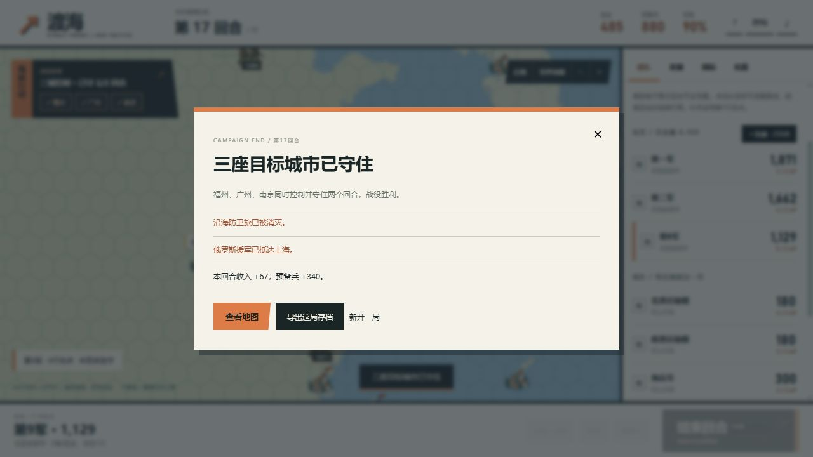
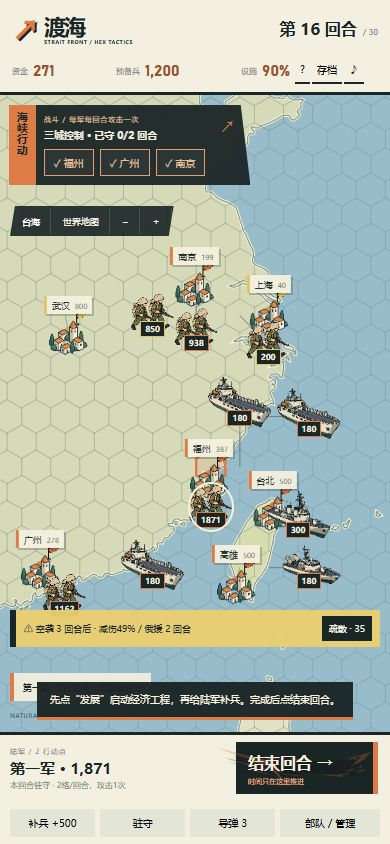

# 2.0 六角格回合版：实玩与验证

日期：2026-10-15。目标：真实地图、简单指挥、国际事件，10–20分钟一局。回合版是独立规则与存档，1.11实时入口及其存档保留。

## 实际浏览器一局

使用正常UI、随机新开局，不注入游戏状态、不修改兵力/资源/回合，不读写隐藏存档来制造结果。开发中为修复界面问题重载同一局，继续正常自动保存的进度。

| 回合 | 实际决策与结果 |
|---|---|
| 1–5 | 第一军补兵；经济逐级升到3；组建第三军并建第三艘运输舰。半岛新闻选择中立，有限合作提供预算。 |
| 6–10 | 科技逐级升到3，外交1；预备兵逐回合补进不同军队，回应企鹅与半岛后续。 |
| 11 | 第一军1520→福州，第二军补到1360→广州，第三军1610→南京。海运分别占用三艘运输舰，真实消耗舰船行动点。用一枚导弹击沉沿海敌艇，保护运兵路线。 |
| 12–13 | 福州攻城预览648/111，结算完全一致；下一次预览327/38后占领。首次空袭将设施100降到90。 |
| 14 | 花90协调民用航运，解除橡皮鸭贸易扰动；福州守军补兵并驻守。其余两军按已保存路线继续推进。 |
| 15 | 第二军进攻广州，预览与结算447/52，成功占领。再用一枚导弹削弱南京守军；第三军自动沿既定路线接近并交战。 |
| 16 | 第三军攻击南京，预览494/58，三城全部控制。保存真实JSON，继续修整守军。 |
| 17 | 南京部队补兵驻守；通过第二轮敌方结算，实际军事胜利。俄方援军在此时进入上海。 |

最终设施90%，资金485，预备兵880；三军剩1871/1662/1129。使用两枚导弹，没有国家合作合同或秘密科研，没有依赖旧版21秒速攻。

“17回合”不等于“17分钟”。这次开发实玩包含检查和修复停顿，不能作为普通玩家用时统计。10–20分钟仍是节奏目标，尚未进行多名玩家计时验收。

## 修复过的问题

独立审查的运输舰AP绕过、无船海格错误高亮、零AP免费驻守、存档字段/固定目标遗漏、鸭子封锁无经济效果，以及旧秒数说明/威慑延迟不一致，均已重现并增加回归检查。

浏览器实玩还发现并修复：没有移动也锁住操作、排队动画时间戳为负导致地图停止刷新、空袭疏散按钮在动画中未正确禁用、同回合多条新闻连续覆盖。现在重大新闻每回合最多一条，剩余后续保留到未来回合。攻击预览也按实际剩余守军封顶。实际首次空袭没有疏散：当时点击落在移动锁内，日志与100→90结算保留，没有将未成功的点击写成减伤成功。

## 核验范围

- 根目录测试212/212，包括35项新六角格、战斗、世界事件、动画与兼容检查；原177项检查保留。
- 四组种子（2/5/12/40）使用正常核心指令模拟军事胜利：第24/19/19/19回合；未伪造资源或占城。
- 同四组正常科研/新闻指令模拟威慑停火：第20/20/23/22回合。该路线本版没有再做完整人工浏览器通关，不能把规则模拟算成人工试玩。
- 桌面实际完整通关。390×844浏览器尺寸验证地图、管理、工程、国际插图、选择与结束回合；通过UI导入真实第16回合存档，再守两轮获胜。不是实体手机触摸测试。
- 另一真实第16回合存档分支检查导弹：上海守军800→420，显示实际命中数字与手绘特效。最终修复版新检查标签页无控制台错误/警告；开发阶段曾发现的首帧错误如上记录。
- 世界地图检查美国、日本、台湾、大陆、俄罗斯、朝鲜、韩国、菲律宾的地区标签；真实城市经纬度和海岸线仍来自Natural Earth。
- 旧实时页使用独立入口及原v7存档。新版本拒绝把旧实时存档误导入六角格规则，不覆盖旧数据。
- 没有人工走遍34个事件、85项回应或全部海战组合；保留素材不代表逐个剧情已由人工看到，审美和可玩性仍待用户验收。

构建、Pages成功状态及公开文件字节一致性由本次发布记录另行确认。
