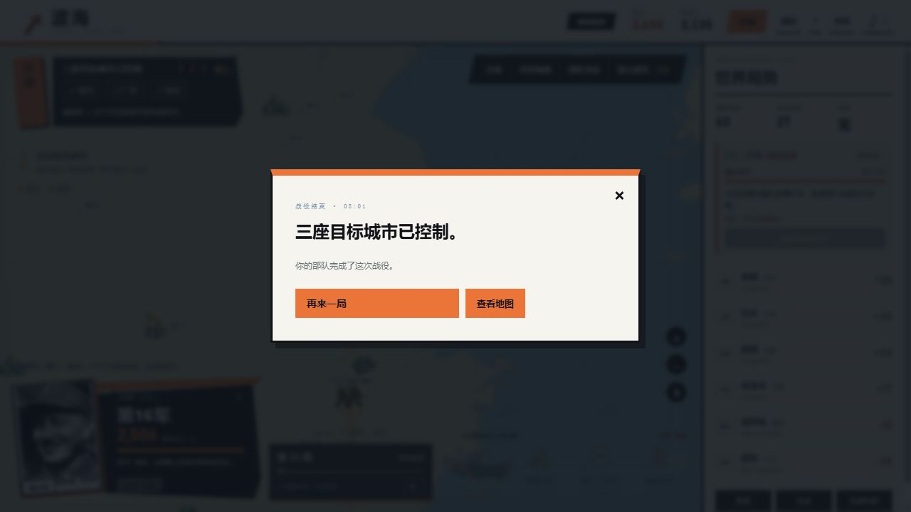
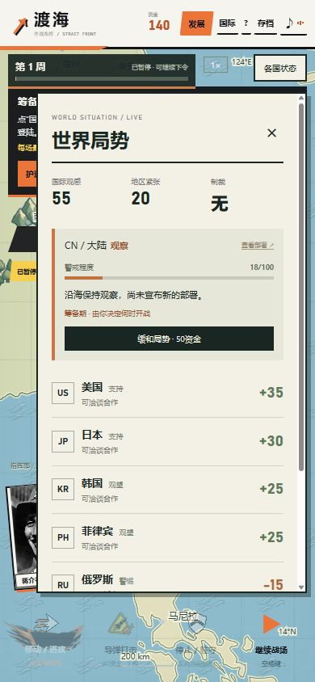

# 2.1 实时世界版验证 — 2026-10-15

用户反馈六角格版不合适，明确要求恢复旧实时玩法，并增加随机事件、大陆回应、更宽松的时间和每周进度；右侧国家状态保留。

## 自动检查

- 全仓库226项测试通过，包括新增14项时间、世界动态与迁移测试；网页构建与独立游戏构建均运行。
- 默认速度下20真实秒推进10模拟秒；暂停不推进，2倍速显式切换；移动预计时间跟随速度。
- 40个新开局种子覆盖多种不同起始事件和出现时间，排除需要科研前提及仅后续事件；相同种子可复现。
- 大陆外交施压与动员先预告再落实；真实生成守备队。首次登陆不必等定期评估，会立即调整反击计划。
- 沟通真实花费50资金、取消未执行部署，并有冷却；存档保留随机状态、部署和反击记录。
- v7迁移保留军队、科研、原新闻排程；非法速度、部署类型、历史与期限拒绝导入。
- 不同沿海动员选择不同可用城市；新增大陆部队不占掉俄罗斯机甲剧情所需容量。
- 四个正常指令模拟种子2/5/12/40均控制三城获胜，每个执行58次存档校验。此项是规则模拟，不是人类实际游玩。

## 实际浏览器试玩

用正常按钮从新局开始，发展经济3、科技3、外交1；招募第三军、补兵、造第三艘运输舰。原有三军分别进攻福州、广州、南京。没有修改浏览器状态或注入资源，没有签外国合作合同，也没有使用战略武器。

开场实际抽到欧洲复活风波，之后出现欧洲后续、菲律宾救援、媒体质询、月面兔子和较晚出现的朝鲜猜拳事件。军队扩张后，上海实际出现650人大陆守备队。右侧“查看部署”可定位；花50资金取消过一轮尚有8秒的动员。

完整试玩曾获胜。最终复核加入“首次登陆立即识别”后，通过文件选择器重新导入先前实际导出的备战存档，重玩登陆段：大陆在首次登陆后显示反击预告，随后实际补充地图上的守备队。最终301.25模拟秒、第11周三城控制、三军驻守获胜，基础设施100%。采用游戏内2倍速；开发、暂停和读新闻时间不作为10–20分钟的人类用时证明。

## 手机与输入验证

390×844浏览器视口实际测试：展开各国状态、点击日本进入关系详情、关闭面板；通过文件选择器导入1.11真实v7备战存档成功。第一军点高雄下达驻守命令。

暂停期间间隔1.2秒，两次读取均为165.3模拟秒、周进度50.8543%。恢复约1.8秒后移动预计时间从14秒减少到12秒，再次暂停。四个命令均处于屏幕范围内；国家侧栏通过展开/收起保留地图空间。

桌面和手机验证会话均未记录控制台错误或警告。手机尺寸验证不代表实体手机实测。浏览器技术检查和通关不代表玩家已经认可趣味性。

## 保留与发布方式

旧v7存档键保留，v8使用新键；六角格入口与独立存档保留在`hex.html`。当前网站仍通过原仓库main分支的GitHub Pages流程部署。发布后的文件比对应使用提交中的Git blob，不以工作区副本替代。
